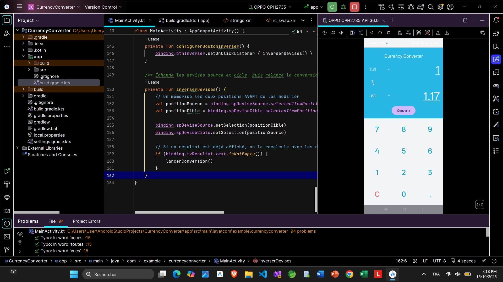
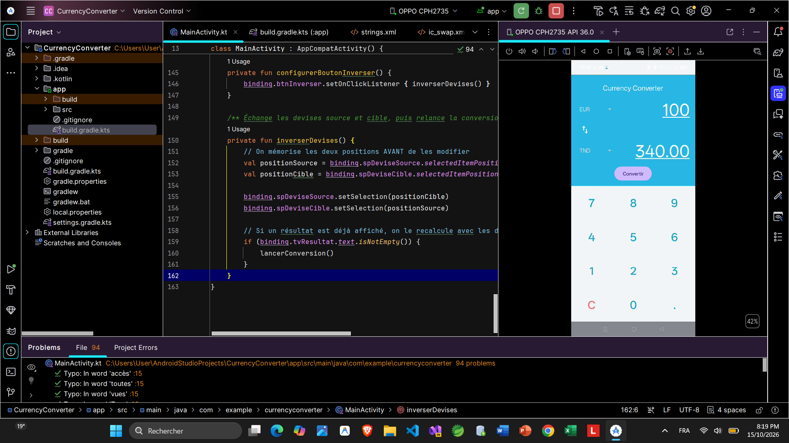
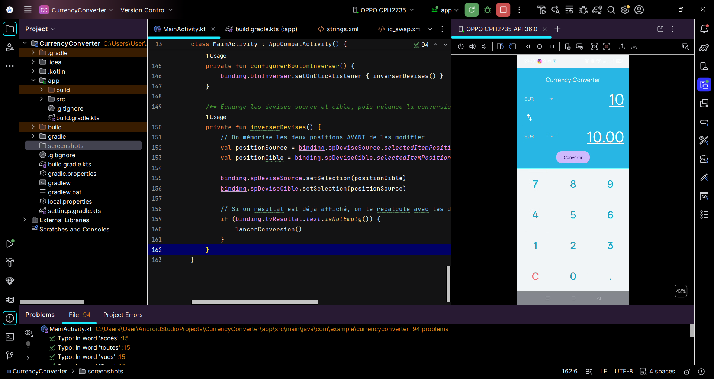

# Currency Converter (Android / Kotlin)

Application Android qui convertit un montant d'une devise vers une autre
à partir de taux fixes, avec un clavier numérique personnalisé.

## Fonctionnalités
- Conversion entre USD, EUR, TND, GBP, JPY, CAD (EUR comme devise pivot)
- Clavier numérique personnalisé (TableLayout), touche C pour effacer
- Bouton ⇅ pour inverser les devises
- Règles : un seul point décimal, 10 caractères maximum, Toast si le montant est 0
- Orientation bloquée en portrait

## Technologies
- Kotlin, Android Studio
- View Binding, ConstraintLayout, TableLayout, Spinner + ArrayAdapter
- SDK minimum : API 24

## Lancer le projet
1. Cloner le dépôt
2. Ouvrir le dossier dans Android Studio
3. Laisser Gradle se synchroniser, puis lancer sur un appareil ou un émulateur

## Captures d'écran

| Démarrage | 120 USD → EUR |
|---|---|
|  |  |

| 100 EUR → TND | 50 GBP → USD | 10 EUR → EUR |
|---|---|---|
|  |  |  |

## Auteur
Ahmed Salah — ISET Djerba, Licence DSI